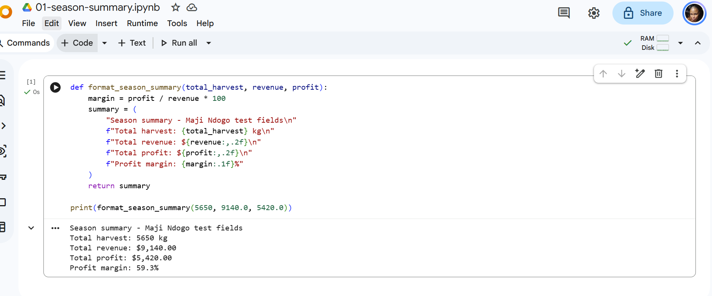
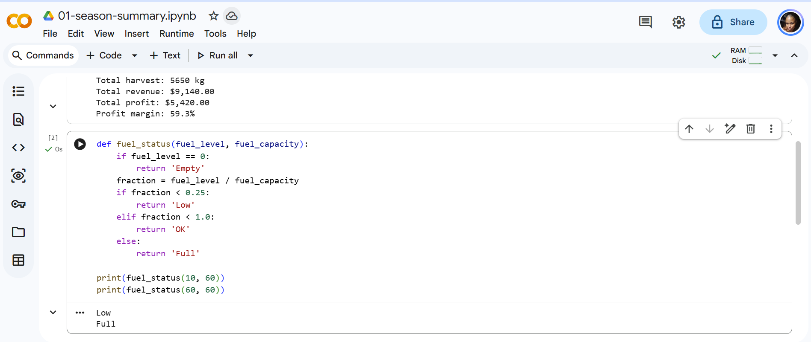
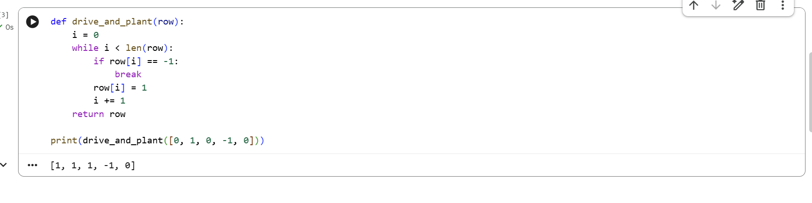
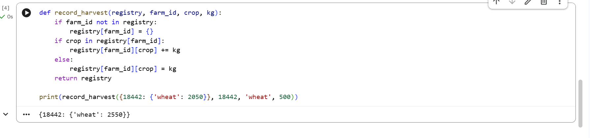

# Maji Ndogo Farm Analytics: From a Notepad to a Field Plan

*Python Foundations case study | ALX Africa Data Science*

---

## The Business Problem

At 6:47 a.m., an hour before the minister's meeting, the Maji Ndogo Ministry of Agriculture's season figures existed only as messy handwritten notes, with nothing calculated or traceable. Without a record it could check and rerun, the ministry couldn't defend its numbers or begin to investigate why yields across Maji Ndogo's farms vary so much.

Three weeks into the pilot, a second problem surfaced in the field. A test tractor ploughed the same strip down the middle of a field over and over until someone switched it off, leaving the rest bare. The hardware was fine. Nobody had written a path-planning algorithm.

---

## The Tech Stack

- **Language:** Python 3, core language only, with no external libraries
- **Environment:** marimo notebooks
- **Building blocks:** data types and string formatting, lists, tuples, sets and dictionaries, conditionals and loops, list and dictionary comprehensions, and functions with default arguments, `*args` and `**kwargs`

No libraries, by design. Every result is built from Python's own building blocks, so every number can be traced line by line by whoever picks up the code next.

---

## The Deliverable

Over three weeks I built a working model of the ministry's farms in code, one the ministry owns and can build on. It **records** what happened (Week 1), **reasons** about it (Week 2) and **plans** what the machines should do (Week 3), in a form anyone on the team can check, rerun and extend.

### Week 1: Records

**1. The notepad becomes a season record.** Two test fields' figures become a formatted summary for Finance: 5,650 kg harvested, $9,140.00 revenue, $5,420.00 profit and a 59.3% margin.

### Week 2: Reasons

**2. Fuel is checked before a tractor sets off.** A tank at 10 of 60 returns `'Low'`; a full tank returns `'Full'`.

**3. The tractor stops at the irrigation pipe.** It plants each cell until it reaches the pipe (`-1`), then stops. It never plants the pipe or anything beyond it.

**4. Harvests accumulate instead of overwriting each other.** A second wheat reading of 500 kg for field 18442 adds to the existing 2,050 kg, giving 2,550 kg.

### Week 3: Plans

**5. Every cell is covered once, with no backtracking.** On a 2 x 3 field starting from the left, the plan flips direction each row and visits all six cells exactly once.

---

## The "So What?"

When the tractor goes out, the whole field gets planted, once, and it comes back. Before, a tractor ploughed the same strip over and over, and every wasted pass was diesel paid for and planting days lost. Now the plan it follows sweeps every row in turn without doubling back, checks fuel before setting off and stops at the irrigation pipe instead of driving into it. The project doesn't measure the fuel saved, so I don't put a figure on it, only that the waste it describes stops.

